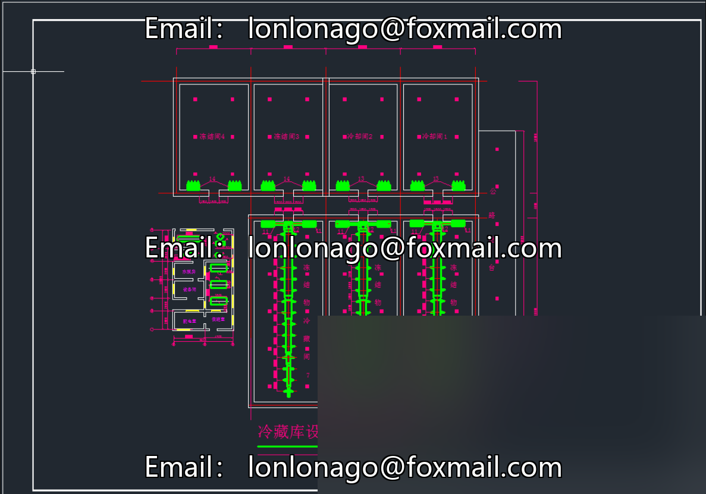
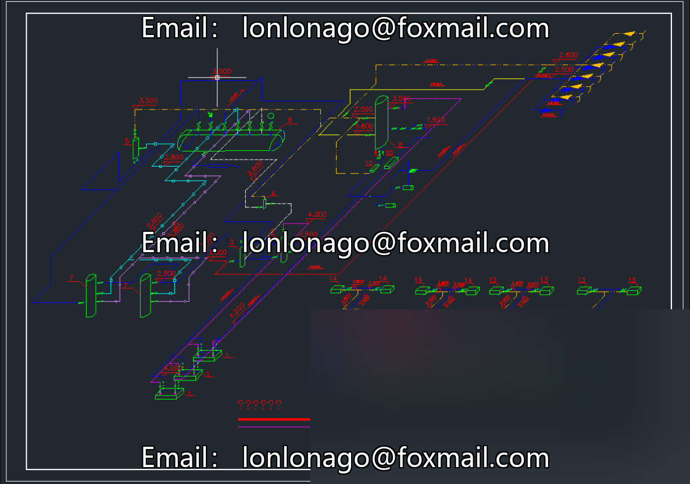
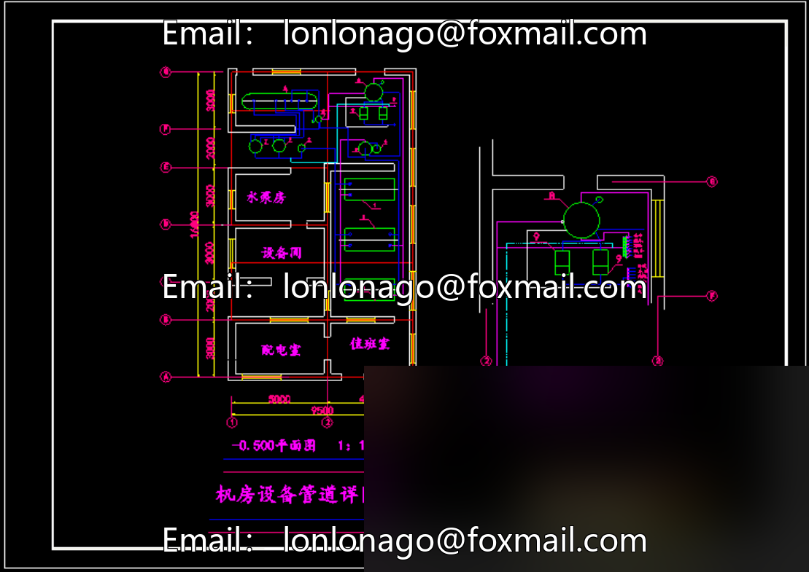
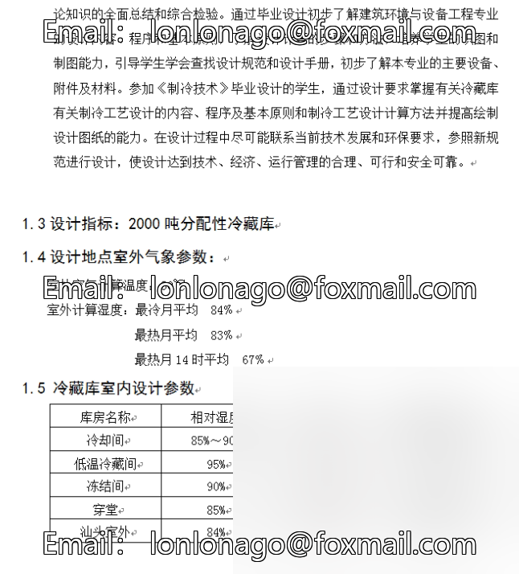

# Refrigeration storage design CAD

## Body

Cold storage design CAD file source 527 Cold storage design cold storage design design drawing cold storage design CAD file, the document includes CAD drawings plus instructions, additionally provides multiple reference materials and instructions for cold storage design

The refrigeration library CAD drawings cover freezing rooms, cooling rooms and equipment layout, along with design instructions, design indicators and cold distribution layouts.

<!-- AI_ENRICHED -->

## Images

## Payment

Here is a pay link on Stripe ( https://buy.stripe.com/3cs8yP7sY87d0vu9AB ). Please contact me lonlonago@foxmail.com after funding $89, and I will send you a complete data files , thank you!

